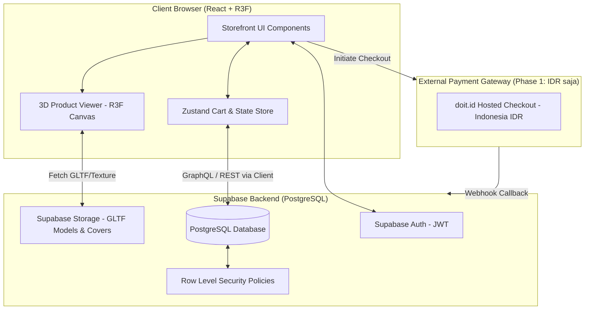

# Technical Requirement Document (TRD) — Prolog.co

**Status:** Draft Baseline v1.0  
**Tanggal:** 6 November 2026  
**Project:** Prolog.co Technical Infrastructure  

---

## 1. Tech Stack Overview & Rationale

| Layer | Teknologi Dipilih | Alasan & Justifikasi | Prior Art / Reuse Pattern |
|---|---|---|---|
| **Frontend Framework** | React 19 + Vite 6 | Kecepatan build bundler, SPA ringan, kompatibel penuh dengan ekosistem Three.js/R3F. | Mirip setup bundler Vite di `digitaltwin` (`package.json`). |
| **3D Rendering Engine** | Three.js + React Three Fiber (`@react-three/fiber`, `@react-three/drei`) | Integrasi deklaratif React dengan WebGL. Menggantikan Three.js imperatif manual untuk keterbacaan komponen. | Re-use struktur material singleton & `THREE.InstancedMesh` dari `digitaltwin/src/scene/materials.js`. |
| **State Management** | Zustand | Lightweight client-side state store (cart, variant selection, checkout drawer) tanpa boilerplate Redux. | Sederhana, zero-boilerplate. |
| **Backend & Database** | Supabase (PostgreSQL + Auth + Storage) | Serverless BaaS serbaguna: RLS security, Postgres trigger, auth OAuth + email, file storage untuk GLTF 3D & image assets. | Mengikuti pola `idssmbg` (`supabase/schema.sql`, RLS helper function). |
| **Payment Gateway** | doit.id (Indonesia, IDR) | Hosted checkout untuk metode QRIS dan Virtual Account yang aktif di akun merchant; status order diperbarui lewat webhook bertanda tangan. Stripe (USD internasional) ditunda. | API key tersimpan di Supabase Edge Function; checkout hosted, bukan form kartu di storefront. |
| **Testing** | Node.js native test runner (`node --test` + `node:assert/strict`) | Pengujian logika bisnis murni (kalkulasi harga, validasi diskon, aturan SKU) tanpa dependensi runner berat. | Direplikasi langsung dari konvensi `digitaltwin/tests/`. |

---

## 2. Architecture & Data Flow



---

## 3. Frontend & 3D Viewer Architecture

### 3.1 Komponen & Modul Main Window
- `src/components/3d/BookViewer.jsx`: R3F Canvas pembungkus model 3D buku Sudoku.
- `src/components/3d/materials.js`: Dict pusat berisi instance `MeshStandardMaterial` / `MeshPhysicalMaterial` yang dibagikan ke seluruh mesh (mencegah *re-instantiation* memori GPU).
- `src/components/store/VariantPicker.jsx`: Interface toggle 2 sumbu (Konten: Journaling/Pure, Edisi: Monthly/Reguler) yang secara instan mengupdate mesh texture kover buku di 3D Viewer.
- `src/store/useCartStore.js`: Zustand store penyimpan item keranjang belanja dengan persistensi `localStorage`.

### 3.1a Modul Admin Dashboard (Route Terproteksi `/admin`)
Admin dashboard dibangun di dalam SPA yang sama menggunakan React Router dengan route guard berbasis role (dibaca dari tabel `user_roles`, bukan hanya klaim JWT):
- `src/pages/admin/AdminLayout.jsx`: Wrapper route terproteksi — verifikasi role `superadmin`/`admin` sebelum me-render konten, sidebar navigasi modul.
- `src/pages/admin/CatalogManager.jsx`: Tabel produk & varian dengan inline-edit `price`, `stock`, dan toggle `aktif` (query langsung ke `product_variants`, dijaga RLS admin write).
- `src/pages/admin/OrderManager.jsx`: Filter orders per status (fokus `paid`), input `tracking_number`, ganti status ke `shipped` — perubahan status memicu trigger email resi.
- `src/pages/admin/StatsPanel.jsx`: Ringkasan agregat sederhana (total penjualan, jumlah order per status, SKU terlaris) via SQL view/aggregate query.
- `src/pages/admin/AdminRoles.jsx`: Hanya untuk `superadmin` — kelola entri `user_roles` (tambah/hapus admin, ubah role).
- Buat route `/admin` dan seluruh sub-halamannya `noindex` dan tidak tertaut dari navigasi publik.

### 3.2 Optimasi Performa 3D (Refleksi Pola `digitaltwin`)
1. **Material Sharing:** Tidak membuat `new MeshStandardMaterial()` di dalam render loop komponen. Seluruh material didefinisikan sekali di `materials.js`.
2. **Setup Environtment Sekali Run:** Menggunakan PMREM generator untuk environment map kover buku yang di-cache saat canvas 3D pertama kali dipasang (*mount*).
3. **PixelRatio Capping:** Menggunakan `window.devicePixelRatio` yang dibatasi `Math.min(window.devicePixelRatio, 2)` untuk menghindari kelelahan GPU pada layar retina/4K mobile.
4. **InstancedMesh Preparedness:** Struktur kode disiapkan menggunakan `InstancedMesh` + `setColorAt` agar saat Phase 2 (Booksleeve/Keychain) rilis, swatch warna dapat di-swap tanpa mereconstructing geometri 3D.

---

## 4. Non-Functional Requirements (NFR)

### 4.1 Performance Budget
- **Time to Interactive (TTI):** < 3.0 detik pada jaringan 4G mobile.
- **Ukuran Aset 3D:** Model GLTF buku Sudoku terkompresi Draco < 2.5 MB.
- **FPS Rendering:** Minimal 30 FPS pada browser ponsel kelas menengah (*mid-range*).

### 4.2 SEO Strategy & Mitigasi SPA (React + Vite)
Karena website menggunakan React SPA (bukan SSR Next.js), maka strategi SEO diterapkan melalui:
- **Build-Time Prerendering:** Menggunakan Vite prerender plugin (`vite-plugin-prerender`) untuk menghasilkan file HTML statis per halaman produk (`/product/sudoku-journaling-monthly`, dll) sehingga dapat di-crawl sempurna oleh Googlebot.
- **OpenGraph & Schema.org JSON-LD:** Penambahan metadata `Product` dan `BreadcrumbList` terstruktur pada file statis prabuild.

### 4.3 Accessibility (A11y) & Fallback
- **WCAG 2.2 AA Compliance:** Kontras teks tombol/kartu minimal 4.5:1.
- **Non-3D Fallback:** Jika browser pengguna gagal menginisialisasi WebGL (atau berada pada *reduced motion mode*), 3D Canvas secara otomatis digantikan dengan galeri foto 2D berkualitas tinggi tanpa memutus flow pembelian.

---

## 5. Testing & CI/CD Strategy

### 5.1 Unit & Integration Testing (Non-UI Logic)
Menggunakan Node.js native test runner (`node --test tests/*.test.mjs` + `node:assert/strict`) tanpa dependensi tambahan untuk menguji:
- Logika kalkulasi total belanja & estimasi ongkir.
- Pemetaan kombinasi 2 sumbu biner ke ID SKU yang benar.
- Pengujian penanganan respons webhook pembayaran.

### 5.2 CI Pipeline (GitHub Actions)
```yaml
# Flow CI singkat
name: CI Pipeline
on: [push, pull_request]
jobs:
  test:
    runs-on: ubuntu-latest
    steps:
      - uses: actions/checkout@v4
      - uses: actions/setup-node@v4
        with: { node-version: 22 }
      - run: npm ci
      - run: node --test tests/*.test.mjs
```
