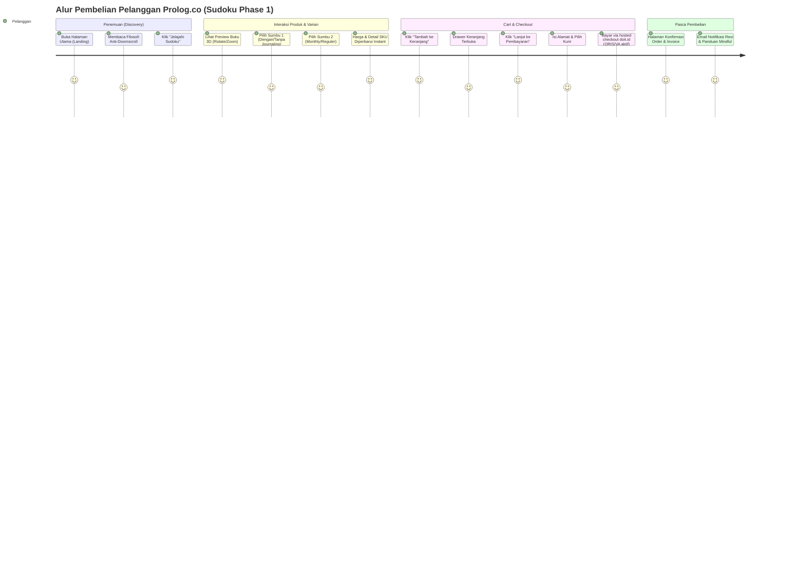
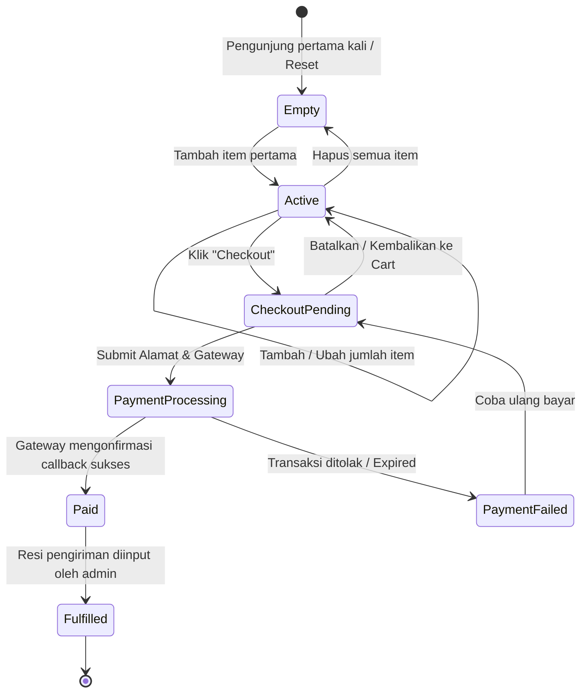
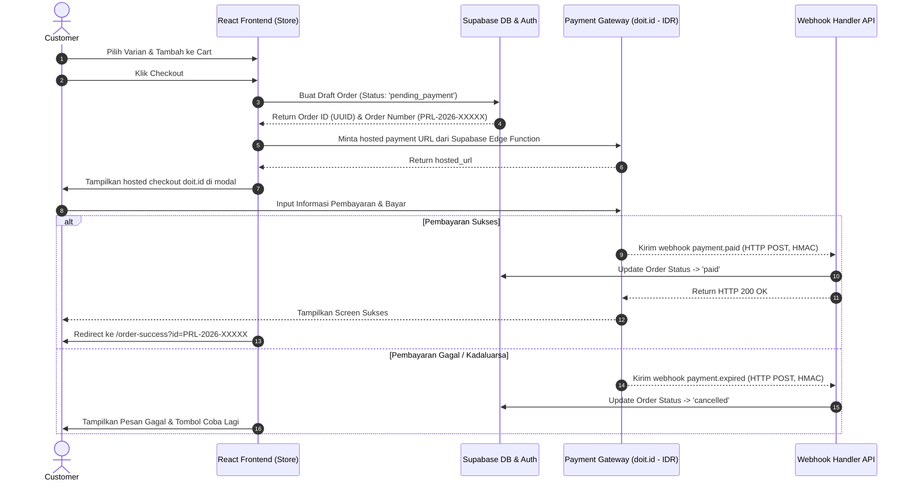

# App Flow Documentation — Prolog.co

**Status:** Draft Baseline v1.0  
**Tanggal:** 6 November 2026  
**Project:** User Journey & Application State Flows  

---

## 1. Primary Customer Journey Map



---

### 1.1 State Halaman Produk "Coming Soon" (Booksleeve & Keychain)
Line non-Sudoku tetap tampil di katalog dan memiliki halaman produk, namun dalam state teaser:
- Kartu produk menampilkan badge "Coming Soon", tanpa harga dan tanpa CTA "Tambah ke Keranjang".
- Viewer 3D menampilkan model placeholder yang diredam (desaturasi) — tetap konsisten dengan janji brand visual 3D di semua lini.
- Tidak ada flow pembelian; hanya teks pengantar bahwa lini akan segera dirilis.

---

## 2. Variant Selection Logic & Price Resolution

Pelanggan memilih varian produk Sudoku melalui dua kontrol toggle biner independen. Sistem langsung memetakan kombinasi tersebut ke 1 dari 4 SKU resmi tanpa *price delta calculation engine* kompleks (karena harga sudah ditentukan kaku per SKU di Phase 1).

### 2.1 Pemetaan Matrix Toggle ke SKU & Harga

```
                 [ Sumbu 1: Konten ]
               /                     \
   (Dengan Journaling)         (Tanpa Journaling / Pure)
          /           \               /            \
   [Monthly]       [Reguler]     [Monthly]      [Reguler]
       |               |             |              |
  SDK-JRN-MTH     SDK-JRN-REG   SDK-PUR-MTH    SDK-PUR-REG
  (Rp 69.000)     (Rp 149.000)  (Rp 49.000)    (Rp 119.000)
```

---

## 3. Cart State Diagram



---

## 4. Checkout & Payment Sequence Flow



---

## 5. Admin & Content Operations Flow (Phase 1: Admin Dashboard Built-in)

Phase 1 menyediakan **Admin Dashboard ringan** di route SPA terproteksi `/admin` (akses hanya untuk role `superadmin`/`admin` via tabel `user_roles` + RLS). Supabase Studio tetap dipertahankan sebagai jalur cadangan untuk troubleshooting teknis, bukan sebagai alur operasional utama.

### 5.1 Modul Dashboard
1. **Katalog & Varian:** Admin membuka `CatalogManager`, mengedit nilai `price`, `stock`, atau toggle `aktif` pada tabel `product_variants` secara inline (simpan langsung via Supabase client; validasi RLS admin write).
2. **Fulfillment Pesanan:** Admin membuka `OrderManager`, memfilter tabel `orders` dengan status `paid`, menginput kode resi pada kolom `tracking_number`, dan mengubah status pesanan menjadi `shipped`.
3. **Statistik Sederhana:** `StatsPanel` menampilkan ringkasan penjualan, jumlah order per status, dan SKU terlaris.
4. **Kelola Admin:** Superadmin membuka `AdminRoles` untuk menambah/menghapus admin dan mengubah role lewat tabel `user_roles`.
5. **Database Trigger:** Perubahan status pesanan ke `shipped` pada langkah 2 secara otomatis memicu Supabase Edge Function untuk mengirimkan email notifikasi resi kepada pelanggan.

### 5.2 Bootstrap Admin Pertama
Admin pertama tidak dapat diangkat melalui dashboard (tidak ada admin sebelumnya), sehingga di-seed langsung via SQL ke tabel `user_roles` (lihat `05-backend-schema.md` §7) menggunakan Service Role Key.

---

## 6. Anti-Slop UI & Calm UX Commitment

Selaras dengan filosofi brand *Anti-Doomscroll*, seluruh layar transaksi (terutama Cart & Checkout) wajib mematuhi aturan UX berikut (ditegaskan melalui pemeriksaan `antislop-ui`):

- ❌ **No Fake Urgency:** Dilarang menggunakan countdown timer palsu (*"Hanya tersisa 5 menit!"*).
- ❌ **No Forced Upsells:** Dilarang menggunakan pop-up modal agresif sebelum checkout (*"Tambah pena ini hanya Rp 10.000!"*).
- ❌ **No Dark Patterns:** Tombol pembatalan/penghapusan keranjang harus sejelas tombol konfirmasi.
- ✅ **Calm Confirmation:** Tampilan sukses checkout memuat pesan tenang bernuansa istirahat sejenak, bukan pesan hiruk-pikuk seolah dalam perlombaan.
